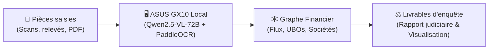

# FinEnclave

**Station locale d'investigation financière et détection d'infractions sur graphes (100 % étanche / Air-Gap)**  
*Projet développé pour l'ASUS Ascent GX10 AI Developer Challenge (NVIDIA Grace Blackwell GB10)*

---

## En bref

Lors d'une saisie judiciaire, les enquêteurs financiers et magistrats font face à des centaines de pièces hétérogènes en vrac : statuts de sociétés, relevés bancaires, pactes d'actionnaires, procurations, registres étrangers. 

En raison du **secret bancaire** et du **secret de l'instruction**, ces documents ne peuvent en aucun cas être envoyés vers un cloud public.

**FinEnclave** traite l'ensemble du dossier en local sur la station **ASUS Ascent GX10** :
1. **Extraction visuelle locale** : lecture des pièces par des modèles de vision spécialisés sous vLLM (`Qwen2.5-VL-72B` pour les actes, `PaddleOCR-VL` pour les tableaux).
2. **Graphe financier déterministe** : fusion des entités, résolution des identités et reconstruction orientée de la chaîne de contrôle et des flux bancaires.
3. **Détection topologique d'infractions** : identification mathématique des circuits fermés (blanchiment), du fractionnement (smurfing) et des bénéficiaires effectifs dissimulés derrière des prête-noms.
4. **Livrables d'enquête** : rapport judiciaire structuré avec cotes de pièces sources et graphe interactif navigable hors ligne.



---

## Pourquoi l'ASUS Ascent GX10 ?

Le format desktop compact (240 W) et les **128 Go de mémoire unifiée LPDDR5x** de l'ASUS Ascent GX10 apportent deux ruptures majeures :
* **Déploiement en cabinet ou salle d'audience** : la machine fonctionne en vase clos complet (*air-gapped*), sans câble réseau ni risque d'exfiltration.
* **Orchestration multi-modèles simultanée** : là où une carte graphique grand public (16 Go) est limitée à de petits modèles 8B, le GX10 fait tourner simultanément un modèle vision de **72 milliards de paramètres en FP8** (~83 Go alloués) et un moteur tabulaire (~10 Go), tout en conservant ~35 Go pour le système d'exploitation et le graphe en mémoire vive.

---

## Démonstration rapide

FinEnclave intègre un jeu de lectures scellées permettant de tester l'intégralité du pipeline et des algorithmes de détection **sans télécharger de modèle lourd ni configurer d'API** :

```bash
# 1. Installation des dépendances avec uv
uv sync --extra dev

# 2. Exécution du dossier de démonstration (Banc 1 : 50 pièces)
uv run python main.py
```

En quelques secondes, l'outil analyse le dossier, détecte les anomalies et génère les livrables dans `data/outputs/investigation/`.

---

## Résultats mesurés : l'apport du GX10

Comparatif mesuré sur le dossier étalon (50 pièces juridiques et bancaires) :

| Métrique | CPU classique | Station RTX (8B) | ASUS GX10 (72B FP8) |
| :--- | :---: | :---: | :---: |
| **Poids du modèle en mémoire** | — | ≈ 8 Go | **≈ 71 Go** |
| **Extraction des entités (Précision / Rappel)** | 1.00 / 0.87 | 0.98 / 1.00 | **1.00 / 1.00** |
| **Reconstitution des virements (P / R)** | 0.89 / 0.74 | 1.00 / 0.43 | **1.00 / 1.00** |
| **Circuit de blanchiment détecté** | ❌ | ✅ | **✅ (100 % des montants)** |
| **Fractionnement détecté** | ❌ | ❌ | **✅ (6 relais identifiés)** |
| **Bénéficiaire effectif occulte identifié** | ✅ | ✅ | **✅ (Chaîne complète)** |

Le passage au modèle 72B permis par le GX10 débloque la lecture exhaustive des tableaux de relevés bancaires denses, condition indispensable pour reconstituer les schémas de fractionnement.

---

## Livrables d'enquête générés

Chaque exécution génère un dossier complet prêt pour la procédure :

* **`rapport.md`** : synthèse d'investigation, chronologie des flux, chaînes de contrôle et réquisitions bancaires suggérées (chaque fait renvoie à la cote `PIECE-xxxx` et à son empreinte SHA-256).
* **`graphe.html`** : visualiseur interactif autonome (aucun CDN externe, compatible avec les navigateurs hors réseau).
* **`noeuds.csv` & `aretes.csv`** : exports tabulaires pour analystes.
* **`import.cypher`** : script d'ingestion directe dans Neo4j.
* **`graphe.graphml`** : format standard pour Gephi / yEd.

---

## Structure du dépôt

```text
fin-enclave/
├── main.py              # Point d'entrée CLI (investigation, benchmark, forges)
├── src/fin_enclave/     # Package Python
│   ├── documents/       # Extraction vision, routage et lecteur de relevés
│   ├── graph/           # Construction du graphe, résolveur et détecteurs d'infractions
│   ├── analyst.py       # Vues d'analyse d'enquête (chronologie, réquisitions)
│   ├── comparison.py    # Moteur de benchmark multi-stations
│   └── reporting.py     # Générateur du rapport judiciaire et du graphe HTML
├── deploy/              # Scripts de déploiement et runbook ASUS Ascent GX10
├── data/demo/           # Dossier étalon (50 pièces) et banc de charge (500 pièces)
├── scripts/             # Outils de métriques, benchmarks et audit mémoire
└── tests/               # Suite de tests unitaires et d'intégration (pytest)
```

---

## Déploiement sur station ASUS GX10

Pour déployer et exécuter les modèles locaux sur la machine physique, consultez le guide dédié :  
👉 **[Guide de déploiement GX10 (`deploy/README.md`)](deploy/README.md)**

```bash
# Lancement de l'environnement vLLM local
./deploy/vllm_service.sh ensemble

# Lancement de l'analyse avec les modèles locaux
uv run python main.py --engine routed
```
